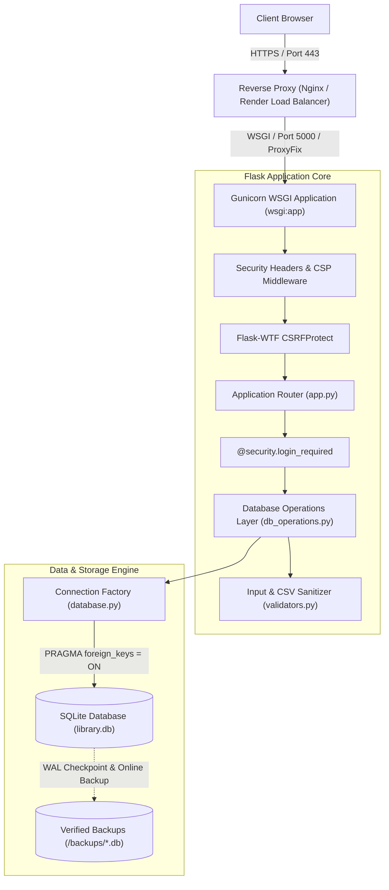
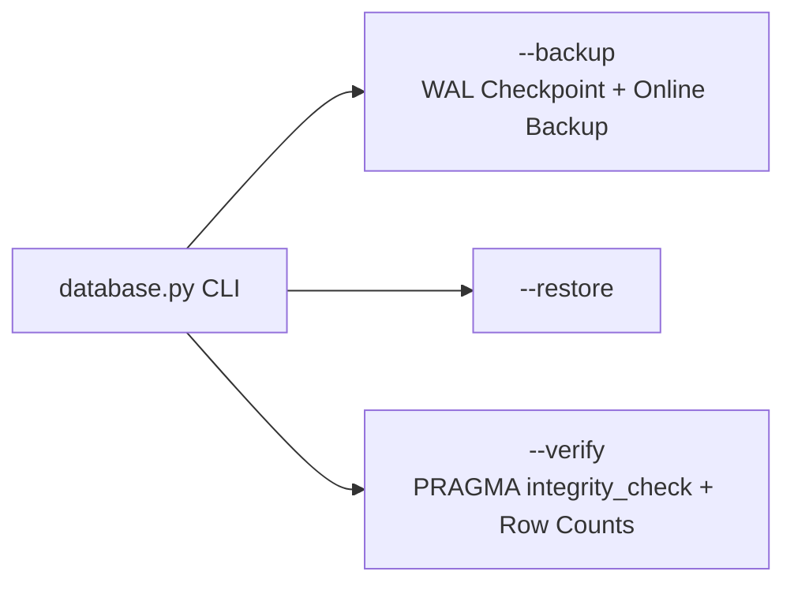

# Athena LMS - Production Library Management System

Athena LMS is a full-stack, production-hardened Library Management System built with **Python Flask**, **SQLite**, **HTML5**, **CSS3**, and **Vanilla JavaScript**. It provides an end-to-end circulation engine, catalog and patron management, authenticated staff portals, defenses against common web vulnerabilities, sanitized CSV reporting, and safe database backup and recovery operations.

---

## 🏛️ System Architecture



---

## 🌟 Core Features & Capabilities

### 1. Catalog & Inventory Management
- **Full Book Lifecycle**: Register new titles, edit volume metadata, track total and available copies, and safely delete unissued books.
- **Search & Filter**: Search by title, author, ISBN, or book code; filter by genre category with real-time responsive UI.
- **Stock Protection**: Enforces database-level `CHECK(available_copies >= 0 AND available_copies <= total_copies)` constraints to prevent negative inventory.

### 2. Patron & Membership Management
- **Patron Directory**: Track Student, Faculty, and General members with active loan counters.
- **Borrower Privileges**: Configurable loan limits (3 titles for students, 10 for faculty).
- **Status Safeguards**: Suspended accounts are immediately blocked from checking out books.

### 3. Circulation Desk & Atomic Transactions
- **Checkout Engine**: Single-click book checkout with auto-calculated due dates (14 days for students, 30 days for faculty).
- **Atomic Stock Synchronisation**: Increments and decrements available copies within atomic SQLite transactions.
- **Return Processing**: Restocks inventory, records return timestamps, calculates overdue periods, and flags damaged books.
- **Circulation Urgency Badges**: Live indicators highlighting "Due Soon" (<= 3 days) and "Overdue" status.

### 4. Decimal Late Fee Calculation
- **Monetary Precision**: Uses Python's `decimal.Decimal` with `ROUND_HALF_UP` rounding to eliminate floating-point arithmetic errors.
- **Configurable Penalty Rates**: Administrative rate adjustments dynamically applied across all future returns.
- **Real-Time AJAX Preview**: `/api/calculate-fine` calculates overdue penalties as users adjust return dates.

### 5. Sanitized CSV Export (CWE-1236 Defense)
- **One-Click Data Exports**: Export catalog (`/books/export`) and patron directories (`/members/export`) as CSV files.
- **Formula Injection Defense**: Neutralizes macro/formula triggers (`=`, `+`, `-`, `@`, `\t`, `\r`) even when preceded by leading whitespace or control characters by safely prepending a single quote (`'`).

---

## 🛡️ Security & Hardening Architecture

| Security Domain | Defense Implementation | Technical Details |
| :--- | :--- | :--- |
| **Authentication** | PBKDF2:SHA256 Password Hashing | Handled via `werkzeug.security`. Passwords never stored in plaintext. |
| **Credential Rotation** | Mandatory First-Login Password Change | Default temporary admin credentials (`admin` / `Admin@Temporary123!`) must be changed immediately on first login. |
| **Brute-Force Defense** | IP & Account Throttling | Tracks failed attempts in SQLite. Locks accounts after 5 failures for 15 minutes. |
| **CSRF Protection** | Flask-WTF CSRFProtect | Enforced across all state-changing `POST` requests and AJAX headers (`X-CSRFToken`). |
| **SQL Injection** | Strict Parameterization | 100% of queries use parameterized SQL (`?` placeholders). No raw string concatenation. |
| **Clickjacking & Sniffing** | Modern HTTP Security Headers | `X-Frame-Options: DENY`, `X-Content-Type-Options: nosniff`, `Referrer-Policy: strict-origin-when-cross-origin`. |
| **Content Security Policy** | Defense-in-Depth CSP | `default-src 'self'; script-src 'self'; style-src 'self'; img-src 'self' data:; font-src 'self'; frame-ancestors 'none'; form-action 'self'`. |
| **Header Hygiene** | Obsolete Header Removal | Deprecated `X-XSS-Protection` is omitted in favor of modern CSP. |
| **Reverse Proxy Safety** | Configurable `ProxyFix` | Applied only when `PROXIES_COUNT > 0` to prevent IP spoofing attacks. |
| **Cookie Hardening** | `HttpOnly`, `SameSite=Lax`, `Secure` | Cookies marked `Secure` in production and HTTPS environments. |

---

## 🗄️ Database Persistence & Safe Recovery CLI

Athena LMS includes a database management and recovery CLI in `database.py`.



### CLI Commands

```bash
# 1. Verify database integrity and print current record counts
python database.py --verify

# 2. Create an automated, verified online snapshot
python database.py --backup

# 3. Safely restore from a backup (creates a pre-restore safety copy first)
python database.py --restore backups/library_backup_YYYYMMDD_HHMMSS.db

# 4. Initialize database schema and seeds
python database.py --init
```

### Safety Guarantees
1. **WAL Flush**: Executes `PRAGMA wal_checkpoint(TRUNCATE);` before backup or restore to prevent partial journal loss.
2. **Pre-Restore Snapshot**: Automatically creates a pre-restore safety snapshot before altering the live database.
3. **Double Integrity Check**: Verifies the backup snapshot before restoring and verifies the target database after restoring.
4. **Foreign Key Enforcement**: `PRAGMA foreign_keys = ON;` is enforced on every database connection.

---

## 🚀 Deployment Guide & Hosting Trade-offs

Athena LMS is packaged for deployment on cloud platforms using Gunicorn and WSGI.

### Cloud Platforms Comparison

| Platform | Free Tier Reality | Database Persistence | Recommendation |
| :--- | :--- | :--- | :--- |
| **Render** | Free web service spins down after 15 min of inactivity. | Ephemeral container storage resets database upon redeploy or restart unless an attached Persistent Disk mount is configured. | Recommended with `DATABASE_PATH=/var/data/library.db` mount or external DB. |
| **PythonAnywhere** | Free tier requires manual "Extend" click every 3 months; restricted outbound internet access. | Filesystem is persistent by default (SQLite file survives restarts). | Good for beginners, but manual renewal is required and outbound networking is restricted. |

### Gunicorn WSGI Configuration
The included `Procfile` specifies single-process, multi-threaded worker configuration:
```
web: gunicorn wsgi:app --workers 1 --threads 4 --timeout 60
```
> **Technical Note on SQLite Concurrency**: Because SQLite uses database-level locking for writes, running Gunicorn with `--workers 1 --threads 4` avoids cross-process file-lock contention while serving concurrent requests safely.

### Deployment Environment Variables

Configure these variables in your hosting provider's dashboard:

```env
APP_ENV=production
FLASK_SECRET_KEY=generate-a-random-64-character-hex-string
SESSION_COOKIE_SECURE=true
DATABASE_PATH=library.db
PROXIES_COUNT=1
PORT=5000
```

---

## 💻 Local Development Setup

### 1. Prerequisites
- Python 3.10+ installed.
- Git installed.

### 2. Clone and Setup
```bash
git clone <your-repository-url>
cd Library-Management-System

# Create virtual environment
python -m venv venv

# Activate virtual environment
# Windows:
.\venv\Scripts\activate
# Linux/macOS:
source venv/bin/activate

# Install dependencies
pip install -r requirements.txt
```

### 3. Initialize Configuration
```bash
# Copy example configuration
cp .env.example .env
```

### 4. Run the Development Server
```bash
python app.py
```
Open [http://127.0.0.1:5000](http://127.0.0.1:5000) in your browser.

### 5. Default Staff Credentials
- **URL**: `http://127.0.0.1:5000/login`
- **Username**: `admin`
- **Password**: `Admin@Temporary123!`
- *You will be prompted to set a new password on your first sign-in.*

---

## 🧪 Automated Testing Suite

The regression test suite runs exclusively on an isolated temporary SQLite database, protecting existing production data from modification or deletion.

### Running Tests
```bash
python -m unittest test_backend.py -v
```

### Test Coverage (15 Suites)
1. `test_01_foreign_key_enforcement_and_tables`: Verifies foreign keys and table existence.
2. `test_02_temporary_credentials_and_forced_rotation`: Verifies forced password change on first login.
3. `test_03_unauthenticated_route_protection`: Verifies route redirects and 401 API guards.
4. `test_04_brute_force_rate_limiting`: Verifies 5-attempt rate-limiting and temporary account lockout.
5. `test_05_input_validators`: Verifies bounds, regex validation, and ISBN checking.
6. `test_06_sql_injection_defense`: Verifies rejection of classic SQL injection vectors.
7. `test_07_decimal_currency_accuracy`: Verifies exact monetary math using `Decimal`.
8. `test_08_book_and_member_crud`: Verifies CRUD persistence for books and members.
9. `test_09_circulation_issue_and_return_lifecycle`: Verifies atomic checkouts, stock counts, and duplicate prevention.
10. `test_10_csrf_protection_enforcement`: Verifies 403 Forbidden on missing CSRF tokens.
11. `test_11_csv_formula_injection_sanitization`: Verifies formula trigger sanitization with leading whitespace.
12. `test_12_csv_export_endpoints`: Verifies `/books/export` and `/members/export` streaming.
13. `test_13_security_headers_and_csp`: Verifies Content Security Policy and absence of obsolete headers.
14. `test_14_database_backup_restore_and_wal`: Verifies online backups, pre-restore safety copies, and WAL checkpoints.
15. `test_15_proxy_fix_configuration_safety`: Verifies trusted proxy forwarding with ProxyFix.

---

## 📁 Project Structure

```
Library-Management-System/
├── app.py                     # Application factory, routes, CSP, error handlers
├── wsgi.py                    # Production WSGI server entry point
├── database.py                # SQLite connection factory, migrations, and CLI backup/restore
├── db_operations.py           # Atomic CRUD operations, circulation logic, Decimal late fees
├── security.py                # Authentication, brute-force rate limiter, route decorators
├── validators.py              # Server-side input validation suite & CSV sanitization
├── test_backend.py            # 15 automated regression test suites (runs on temporary DB)
├── requirements.txt           # Dependencies (Flask, Flask-WTF, gunicorn)
├── Procfile                   # Cloud process definition (Gunicorn 1 worker, 4 threads)
├── runtime.txt                # Python runtime specification (python-3.11.9)
├── .env.example               # Environment variable reference
├── .gitignore                 # Safe git exclusion rules for DB, cache, and secrets
├── library.db                 # SQLite database (git-untracked)
├── backups/                   # Verified database snapshots (git-untracked)
├── static/
│   ├── css/
│   │   └── style.css          # Design system, responsive layout, modal styles
│   └── js/
│       └── main.js            # Modal ergonomics, escape key listener, live fine calculator
└── templates/
    ├── base.html              # Base layout with navigation and alert messages
    ├── login.html             # Staff login portal
    ├── change_password.html   # Mandatory first-login password rotation interface
    ├── error.html             # Unified error pages (400, 401, 403, 404, 500)
    ├── dashboard.html         # Live dashboard analytics & circulation feed
    ├── books.html             # Book catalog with add, edit, and export controls
    ├── members.html           # Patron directory with registration and export controls
    ├── issue_books.html       # Book checkout interface & active loans
    └── return_books.html      # Book return desk with Decimal fine calculation
```

---

## 📜 License

This project is licensed under the MIT License.
